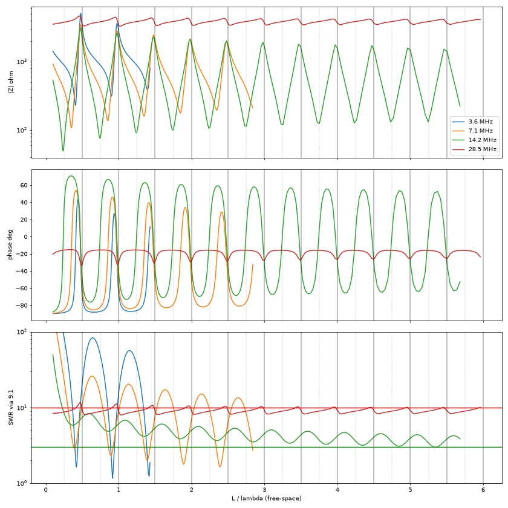
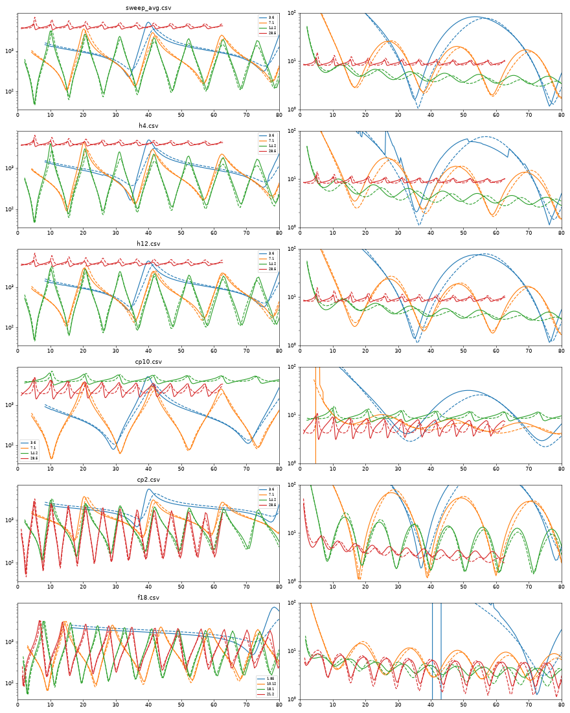
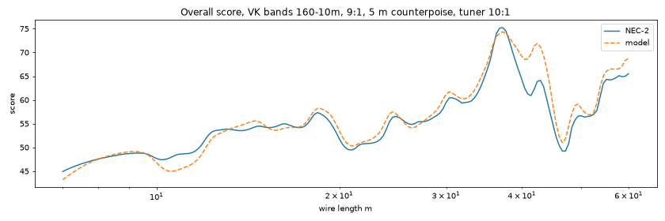

# Impedance model and NEC-2 checks

The calculator scores a wire length by modelling its feedpoint impedance on every selected
band. This folder has the NEC-2 simulations used to fit and check that model.

## The model (docs/js/model.js)

- The wire and the counterpoise are each an open-ended lossy transmission line,
  `Zin = Z0·coth((α + jβ)L)`, connected in series at the feedpoint.
- `αL = (k·Rrad(kL) + Rloss) / Z0`, so the input resistance at a current maximum is the
  radiation resistance plus a loss resistance. `Rrad` is the standard sinusoidal-current
  formula (73 Ω for a half-wave dipole; a monopole is half a dipole of twice the length).
- The impedance is divided by the transformer ratio (9 for a 9:1 unun) and turned into SWR
  on 50 Ω coax.
- Each test frequency gets a mark `1 / (1 + (ln SWR / ln SWRmax)^4)`: 0.5 at the tuner's
  SWR limit. A band's score is the mean mark across the band (edges included) × 100, and a
  length's score is the mean of the band scores.

Fitted constants (`fit.json`, from `fit2.py`):

| Constant | Value | Meaning |
|---|---|---|
| wire Z0 | 462 Ω | `0.778 × 60·ln(4h/d)` at h = 8 m, d = 1.6 mm |
| wire VF | 0.992 | bare wire, includes end effect |
| wire Rloss | 23 Ω | ground loss etc. at a current maximum |
| wire radiation scale | 0.58 | low wire over ground radiates less than in free space |
| counterpoise Z0 | 396 Ω | |
| counterpoise VF | 0.949 | |
| counterpoise Rloss | 0.4 Ω | |
| counterpoise radiation scale | 0.44 | |

## NEC-2 setup (nec_sweep.py)

PyNEC 2.3.4 (`pip install PyNEC`). The install modelled:

- feedpoint 1.5 m above average ground (Sommerfeld, εr = 13, σ = 0.005 S/m), 0.2 m
  vertical source segment
- wire slopes up to 8 m over the first 10 m horizontally, then runs horizontally
- counterpoise runs horizontally the other way at the feedpoint height
- 1.6 mm diameter bare wire, 24 segments per wavelength

Sweeps in `data/` (columns f MHz, L m, R Ω, X Ω): `sweep_avg` (top 8 m, 5 m counterpoise),
`h4` / `h12` (top 4 m / 12 m), `cp2` / `cp10` (2.5 m / 10 m counterpoise), `f18` (1.85, 10.12,
18.1, 21.2 MHz), and `bands_cp5` (7 to 60 m at the edges and centre of each VK band,
160m to 10m).

## Results



- Peaks in |Z| sit just under each multiple of a half wavelength (about 0.47λ, 0.97λ on 80m)
  and dips just under each odd quarter wavelength. Peak height falls slowly with length
  (about 2.5 kΩ at λ/2 to 1.5 kΩ at 5.5λ on 20m), so long wires are still clearly resonant.
- Through a 9:1 unun the SWR is worst just *above* each half-wave multiple, where R is low and
  X is strongly capacitive, not at the half-wave point itself (which gives about 3 to 4 kΩ,
  close to 9:1's 450 Ω after the transformer once the reactance is counted).
- Wire height (4, 8, 12 m) made little difference.
- Counterpoise length made a large difference. A 5 m counterpoise is close to λ/2 on 10m,
  adds about 3 kΩ in series, and raises the 10m SWR at every wire length.



Model (dashed) against NEC (solid): one set of constants for all six sweeps. Median SWR
error is about 1.2× (p90 about 2.5×, mostly from small shifts near sharp resonances).



Overall score from NEC impedances against the model's, VK bands 160m to 10m, 9:1, 5 m
counterpoise, tuner limit 10:1: correlation 0.94, mean difference 3 points. Top lengths
(NEC / model): 37.2 / 37.2 m, 42.9 / 42.4 m, 30.7 / 30.4 m, 18.4 / 18.6 m, 24.8 / 24.5 m,
50.1 / 49.5 m.

## Coax shield only (no counterpoise wire)

`nec_coax.py`: the same wire, with the coax shield as the only counterpoise. The coax
(radius 2.5 mm) drops from the feedpoint to 5 cm above the ground, then runs along the ground
away from the wire. The radio end is open, or earthed with a short wire into the ground.
Sweeps in `data/coax{5,10,20}_open*.csv` and `coax{10,20}_earthed.csv`.

`fit_coax.py` fits `tlmodel.coax_stub`: a line with series loss per metre,
`rp·(f/10 MHz)^p`, plus radiation as extra attenuation. The fixed loss resistance used for the
wires gave too much feed resistance on 80m for coax lying on the ground.

| Constant | Value |
|---|---|
| Z0 | 291 Ω |
| VF | 0.966 |
| series loss | 11.1 Ω/m at 10 MHz, × (f/10)^0.48 |
| radiation scale | 0.51 |

- Median SWR error against NEC is about 1.2× (p90 1.4× to 1.8×).
- Score check with 10 m of coax (`validate_coax.py`, `img/score-validation-coax.png`, VK
  bands 80m to 10m): correlation 0.91, mean difference 2.9 points. The model's 80m band score
  is 14 points high (NEC 36, model 50); 40m and up are within 5 points.
- 160m is not checked. With the coax this close to the ground, NEC-2 gives negative feed
  resistance at 1.85 MHz (it does not with the wire counterpoise at 1.4 m).
- Earthing the radio end mainly changed 80m with 10 m of coax (median SWR 1.7×), and changed
  little with 20 m of coax or on 40m and up. The calculator assumes the open end.
- With the same wire, NEC gives higher scores for coax lying on the ground than for a 5 m
  counterpoise at 1.4 m: the lossy ground damps the resonances.

The 80m error comes mostly from the wire model: its fixed loss resistance also gives too much
feed resistance for short wires on 80m with the 5 m counterpoise (model 7 points high).

## Not modelled

Coax loss, common-mode current on the coax with a counterpoise wire or radials, unun loss, nearby objects, other wire shapes,
ground other than "average", and anything not checked against real measurements.

## Re-running

```bash
python3 -m venv venv && venv/bin/pip install PyNEC numpy scipy matplotlib
venv/bin/python nec_sweep.py data/sweep_avg.csv avg 5 8
venv/bin/python fit2.py        # refits, writes fit.json
venv/bin/python overlay.py     # img/model-vs-nec.png
venv/bin/python validate.py    # img/score-validation.png
```
